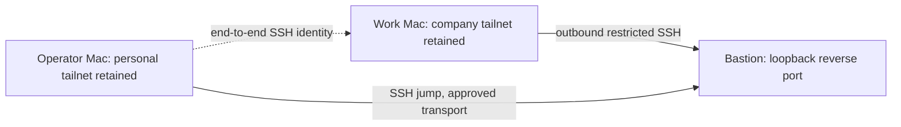

# Stable SSH to a roaming work Mac

Keep company and personal tailnets separate when that is the selected boundary.
Check the existing Tailscale app and active tailnet before installing anything.
An app outside shell PATH can already be connected. Device setup links an
existing `/Applications/Tailscale.app/Contents/MacOS/Tailscale` into the managed
CLI directory only when that path is unused; another installation is preserved.
It never joins a tailnet, changes DNS/routes or replaces a native client.

## Transport choices

| Option | Fit and limits |
| --- | --- |
| Bonjour name + native SSH | Useful same-LAN fallback when DHCP changes; does not cross networks |
| Native SSH over existing Tailscale | Stable across network changes within an authorized tailnet; cross-tailnet device sharing requires admin authorization and is a separate decision |
| Restricted outbound reverse SSH to a bastion | Candidate when tailnets must remain separate; requires an approved, always-on reachable endpoint and reconnect supervision |
| Separate WireGuard tunnel | Can use narrow nonoverlapping routes, but adds endpoint, key, interface, DNS and NAT management; not automatically compatible with another VPN |
| Cloudflare Access/cloudflared SSH | Outbound HTTPS transport can help where ordinary SSH is unavailable; WebSocket SSH has connection-lifetime limits and needs reconnection; client VPN alternatives need a separate coexistence review |
| App-specific userspace overlay | Can avoid host routes and a second system VPN, but adds a separate node identity, access policy and service to maintain; it does not remove the need for an approved trust boundary |

The standalone macOS Tailscale app supports ordinary SSH transport but is not a
Tailscale SSH server. Keep macOS Remote Login and existing approved SSH keys.
An awake, connected laptop and its login state remain prerequisites; a stable
name cannot provide access while powered off or before FileVault unlock.

Sources: [macOS variants](https://tailscale.com/docs/concepts/macos-variants),
[other VPNs](https://tailscale.com/docs/reference/faq/other-vpns),
[device sharing](https://tailscale.com/docs/features/sharing),
[WireGuard NAT keepalives](https://www.wireguard.com/quickstart/),
[Cloudflare SSH routing](https://developers.cloudflare.com/tunnel/concepts/routing/).

### Match the transport to the actual need

For SSH-only administration, test an authenticated SSH channel before adding
another routed VPN. Cloudflare's client-side `cloudflared access ssh` works
without WARP. A connector on the laptop needs outbound TCP/UDP 7844; do not
describe this as a port-443-only origin connection. Alternatively, an existing
always-on server can host the connector and restricted SSH bastion, while the
laptop uses the Access client over HTTPS for its outer connection. Neither
design needs a default route or corporate DNS change. Access identity checks
and native SSH authentication/host keys are separate layers.
Sources: [client-side SSH](https://developers.cloudflare.com/cloudflare-one/networks/connectors/cloudflare-tunnel/use-cases/ssh/ssh-cloudflared-authentication/),
[connector firewall requirements](https://developers.cloudflare.com/cloudflare-one/networks/connectors/cloudflare-tunnel/configure-tunnels/tunnel-with-firewall/).

WireGuard is a reasonable management channel when a reachable UDP hub and
privileged interface setup are available. Use a dedicated management segment,
only required host routes (for example `/32` peers), and no `0.0.0.0/0`, DNS
override, exit routing or corporate/Tailscale address ranges. Verify route
selection before/after rather than assuming two VPNs coexist. An installed
interface with no current handshake is not proof of a working public endpoint;
UDP send success is not a handshake. Preserve unrelated peers and forwarding
rules, especially an existing router or business VPN.

An app-specific userspace node such as `tsnet` can expose one service without
installing a host TUN interface. It still requires a separately authenticated
node and approved access policy; keep its state independent and do not quietly
enroll it in another tailnet after the operator rejected device sharing.
Source: [tsnet server API](https://tailscale.com/docs/reference/tsnet-server-api).

## Check the actual network program

An application firewall such as LuLu can require a new binary's own allow/block
decision. A successful Python or curl TCP probe does not prove that cloudflared
can use the same destination. Compare the exact program, destination, active
firewall profile and rule, and distinguish a pending prompt from a proven deny.
Resolve that decision through the normal app controls; preserve other rules.
Source: [LuLu alerts and rule scope](https://objective-see.org/products/lulu.html).

Transport pilots should expose only a short-lived synthetic nonce. Require an
independent nonce response and a rejected unrelated path before acceptance.
Do not infer readiness by extracting any HTTPS URL from a log: an API hostname
inside an error message can look like a tunnel URL. Registered connectors and
zero process exit codes are also insufficient evidence of the service path.
Stop bounded pilots, revoke their scoped credentials and remove only their own
DNS/tunnel resources. Installation alone should not enable a persistent service.

## Bastion design to review



Use separate forwarding-only accounts/keys for the laptop and operator. The
laptop opens only one remote **loopback** port to its local SSH listener. The
operator reaches that port through the bastion, then authenticates to the Mac
using its existing key and a pinned host identity. Agent forwarding is disabled.
The bastion transports the inner SSH stream; it does not need the work Mac's
login key or an organization private key. Never expose the reverse port on the
public interface or turn the laptop into a subnet router.

An administrator must review the full existing bastion configuration before
adding this illustrative OpenSSH snippet. First-obtained values and existing
Match blocks matter. Validate the effective configuration for both users with
`sshd -T -C ...` before a safe reload; do not copy this over a complete config.

```sshconfig
Match User zf-reverse
    AuthenticationMethods publickey
    PasswordAuthentication no
    KbdInteractiveAuthentication no
    AllowTcpForwarding remote
    AllowStreamLocalForwarding no
    PermitListen 127.0.0.1:22039
    PermitOpen none
    GatewayPorts no
    AllowAgentForwarding no
    X11Forwarding no
    PermitTTY no
    PermitUserRC no
    MaxSessions 0

Match User zf-operator
    AuthenticationMethods publickey
    PasswordAuthentication no
    KbdInteractiveAuthentication no
    AllowTcpForwarding local
    AllowStreamLocalForwarding no
    PermitOpen 127.0.0.1:22039
    PermitListen none
    AllowAgentForwarding no
    X11Forwarding no
    PermitTTY no
    PermitUserRC no
    MaxSessions 0
```

`MaxSessions 0` disallows shell/login/subsystem sessions while permitting
forwarding. Keep the dedicated accounts eligible for public-key authentication
under the host's PAM/account policy. Restrict authorized keys as well; the
reverse key can use `restrict,port-forwarding,permitlisten="127.0.0.1:22039"` and
the operator key `restrict,port-forwarding,permitopen="127.0.0.1:22039"`.
Source: [OpenSSH server configuration](https://man.openbsd.org/sshd_config),
[authorized-key restrictions](https://man.openbsd.org/sshd#AUTHORIZED_KEYS_FILE_FORMAT).

The laptop's client config needs `RemoteForward 127.0.0.1:22039 127.0.0.1:22`,
`ExitOnForwardFailure yes`, `BatchMode yes`, a dedicated key, a verified bastion
host key, and bounded `ConnectTimeout` / `ServerAliveInterval` /
`ServerAliveCountMax`. Run `ssh -N -T` under one named LaunchAgent with throttled
restarts. Keep logs private and avoid duplicate supervisors competing for a port.
A failed or ambiguous connection is not proof the remote port was released.

The operator uses `ProxyJump` through the restricted bastion account, targets
the bastion's loopback reverse port and sets a stable `HostKeyAlias` for the Mac.
Copy that identity only from already verified host keys; never use
`StrictHostKeyChecking no`. Keep a separate LAN alias for recovery.
Source: [OpenSSH client configuration](https://man.openbsd.org/ssh_config).

Acceptance must show the same Mac host key and a fresh SSH nonce through the
bastion, loopback-only server binding, rejected unwanted forwards/shell access,
and reconnect after loss of the outer transport. Compare company model routes,
DNS and active jobs before/after. Perform a different-network test when one is
available. Do not claim roaming acceptance from two clients on the same LAN.
If outbound SSH is blocked or the endpoint is unavailable, report that limit;
do not change tailnet routes or disguise traffic to bypass network policy.

An endpoint, user and trusted host key are required before deployment. A
tailnet-only host is insufficient when the laptop stays on a separate tailnet.
Do not open a new public router port or provision a paid host merely to make a
template runnable. Keep private addresses, accounts and recovery details in
`~/zenithflow/WORKSTATION.md`.
